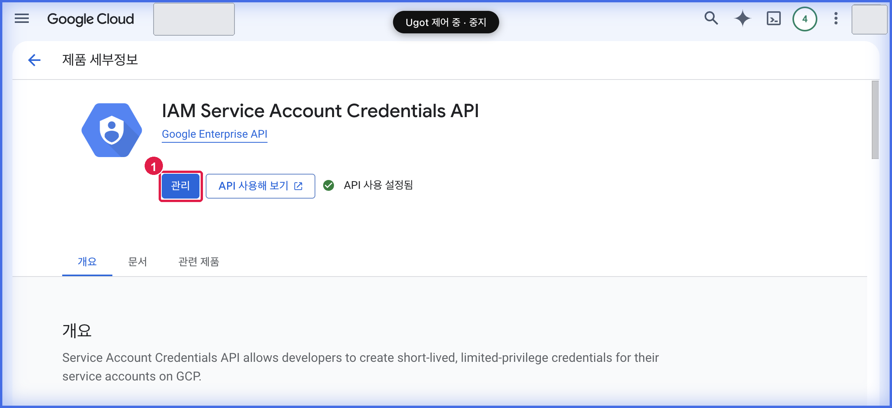
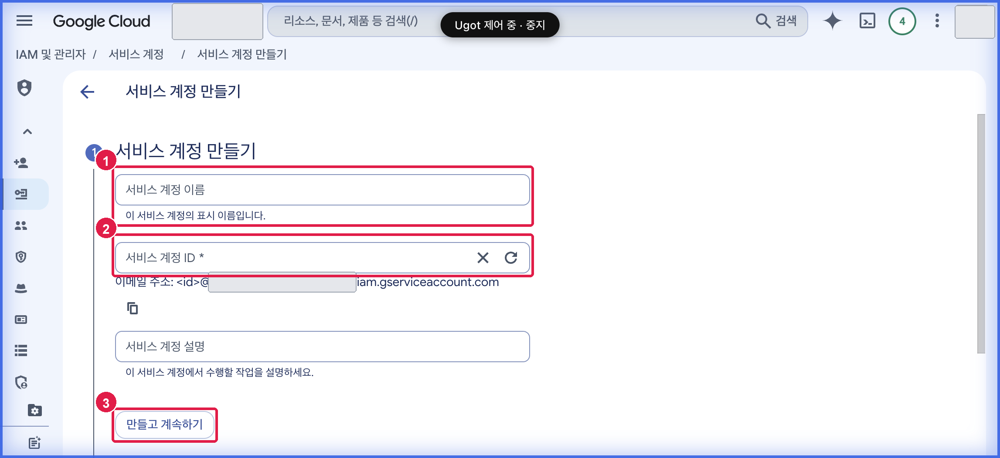
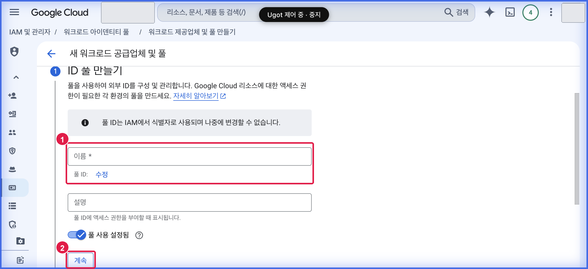
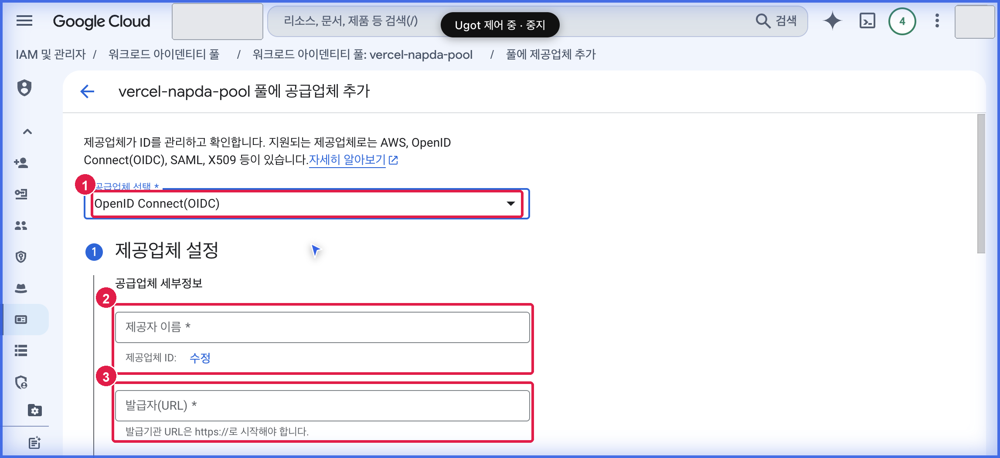
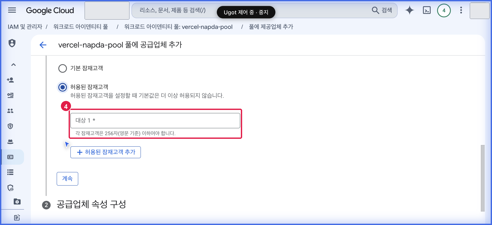
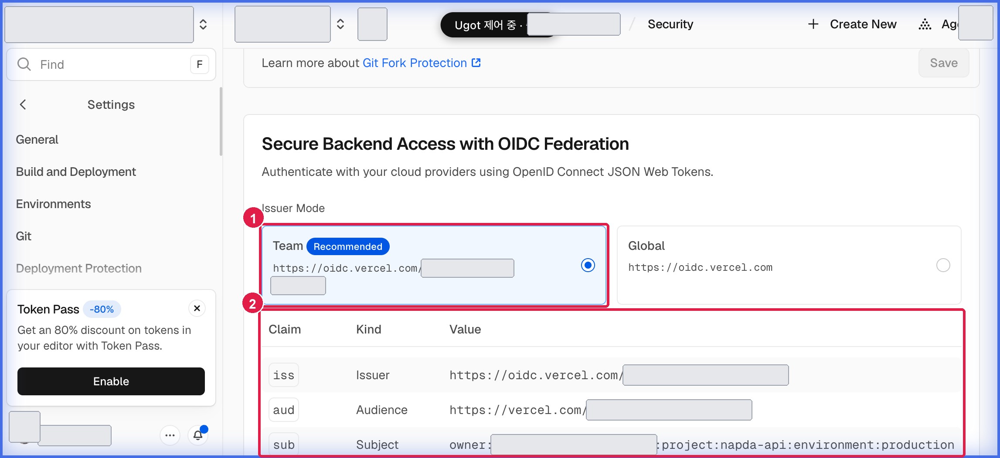
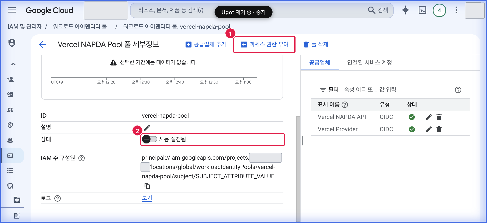

# Vercel (`napda-api`) & Modal (`napda-backend`) ↔ GCP Vertex AI Workload Identity(WIF) 연동 및 추론 가이드

이 문서는 정적 서비스 계정 JSON 키 없이 Vercel 서버리스 백엔드(`napda-api`)와 Modal 컨테이너(`napda-backend`)가 GCP 크레딧으로 **Vertex AI (`google-genai`)** 를 호출하도록 연결하고 추론을 실행하는 가이드입니다.

> **참고 (계정 분리 가능)**  
> 사용자 Google 로그인(OAuth / GIS)에 쓰는 Google 계정·GCP 프로젝트와, Vertex AI 비용/무료 크레딧을 쓰는 GCP 계정은 **서로 달라도 전혀 상관없습니다.**

---

## 사전 준비물
1. **결제 계정(또는 무료 크레딧)이 연결된 본인 명의 GCP 프로젝트** (`<GCP_PROJECT_ID>`, `<GCP_PROJECT_NUMBER>`)
2. **`napda-api`가 배포된 Vercel 팀 slug** (`<VERCEL_TEAM_SLUG>`)
   - 백엔드 디렉터리에서 `vercel teams ls` 또는 `cd backend && vercel project inspect napda-api`로 확인합니다.

---

## 1단계: GCP 프로젝트에 필수 API 3개 활성화
대상 GCP 프로젝트(`<GCP_PROJECT_ID>`)에서 아래 3개 API 페이지로 이동해 각각 활성화합니다:
- **IAM Service Account Credentials API** (`iamcredentials.googleapis.com`)
- **Security Token Service API** (`sts.googleapis.com`)
- **Vertex AI API** (`aiplatform.googleapis.com`, 콘솔 검색 시 *Agent Platform API*로 표시될 수 있음)



- **① `API 사용 설정`** 버튼을 클릭해 활성화합니다 *(이미 활성화된 경우 그림처럼 파란 **`관리`** 버튼과 `API 사용 설정됨`이 표시됩니다)*.

---

## 2단계: Vertex AI 호출용 서비스 계정 생성
GCP 콘솔 **IAM 및 관리자 → 서비스 계정 → 서비스 계정 만들기**:



1. **① 서비스 계정 이름**: `NAPDA Vercel WIF` 입력
2. **② 서비스 계정 ID**: `napda-vercel-wif` 확인 (`napda-vercel-wif@<GCP_PROJECT_ID>.iam.gserviceaccount.com` 생성)
3. **③ `만들고 계속하기`** 클릭
4. 다음 단계(**액세스 권한 부여**)에서 역할 **`Vertex AI 사용자`** (`roles/aiplatform.user` — 한국어 콘솔에서는 **`Agent Platform 사용자`**)를 선택하고 **`계속` → `완료`**를 클릭합니다.

---

## 3단계: Workload Identity Pool & Vercel OIDC 공급업체 생성
GCP 콘솔 **IAM 및 관리자 → 워크로드 아이덴티티 제휴 → 풀 만들기**:



1. **풀 정보**
   - **① 이름**: `Vercel NAPDA Pool` 입력 (풀 ID가 `vercel-napda-pool`로 자동 생성됨)
   - **② `계속`** 클릭



2. **풀에 공급업체 추가 (`OpenID Connect(OIDC)`)**
   - **① 공급업체 선택**: 드롭다운에서 **`OpenID Connect(OIDC)`** 선택
   - **② 제공자 이름**: `Vercel NAPDA API` 입력 (제공업체 ID: `vercel-napda-api`)
   - **③ 발급자(URL)**: `https://oidc.vercel.com/<VERCEL_TEAM_SLUG>` 입력



   - **④ 대상(Audiences)**: **`허용된 잠재고객`** 라디오 버튼을 누르고 **`대상 1`** 칸에 `https://vercel.com/<VERCEL_TEAM_SLUG>` 입력 후 **`계속`** 클릭
3. **공급업체 속성 매핑**
   - `Google 1` = `google.subject`, `OIDC 1` = `assertion.sub` 입력 후 **`저장`**
4. 저장 후 풀/공급업체 상세에서 **전체 Provider 리소스 경로**를 확인합니다:
   ```text
   projects/<GCP_PROJECT_NUMBER>/locations/global/workloadIdentityPools/vercel-napda-pool/providers/vercel-napda-api
   ```



> **Vercel OIDC Issuer Mode 확인**  
> Vercel 대시보드 → `napda-api` 프로젝트 → **Settings → Security → Secure Backend Access with OIDC Federation**에서 **① Issuer Mode**가 **`Team`** 으로 선택되어 있는지 확인하세요. 아래 **② Claim/Value 표**의 `iss`·`aud`·`sub` 값을 그대로 위 3·4단계에 복사해 넣으면 됩니다.

---

## 4단계: 서비스 계정 가장(`workloadIdentityUser`) 권한 부여
방금 만든 풀(`vercel-napda-pool`) 페이지에서 아래 **① `+ 액세스 권한 부여`** 버튼을 눌러 **`서비스 계정을 사용하여 액세스 권한 부여`**를 선택하고 `production`과 `preview` 환경을 각각 1회씩(총 2회) 추가합니다:



- **① `+ 액세스 권한 부여`** 클릭 후 설정값:
  - **서비스 계정**: `napda-vercel-wif@<GCP_PROJECT_ID>.iam.gserviceaccount.com`
  - **속성 매핑 키**: `subject`
  - **속성 값**:
    1. `owner:<VERCEL_TEAM_SLUG>:project:napda-api:environment:production`
    2. `owner:<VERCEL_TEAM_SLUG>:project:napda-api:environment:preview`

*(로컬에서 `vercel env pull`의 `development` OIDC 토큰까지 테스트하려면 `:environment:development`도 추가로 허용하면 되며, 일반 로컬 개발은 `.env`의 `GEMINI_API_KEY` + `GOOGLE_GENAI_USE_VERTEXAI=false` 사용을 권장합니다.)*

---

## 5단계: Vercel (`napda-api`) 환경변수 등록 및 재배포
Vercel 대시보드(`napda-api` → Settings → Environment Variables, **Production / Preview** 모두) 또는 CLI(`backend/` 기준)로 아래 5개를 등록합니다. JSON 키 파일은 필요 없습니다.

| 변수명 | 값 |
| --- | --- |
| `GOOGLE_GENAI_USE_VERTEXAI` | `true` |
| `GOOGLE_CLOUD_PROJECT` | `<GCP_PROJECT_ID>` |
| `GOOGLE_CLOUD_LOCATION` | `us-central1` |
| `GCP_WORKLOAD_IDENTITY_PROVIDER` | `projects/<GCP_PROJECT_NUMBER>/locations/global/workloadIdentityPools/vercel-napda-pool/providers/vercel-napda-api` |
| `GCP_SERVICE_ACCOUNT_EMAIL` | `napda-vercel-wif@<GCP_PROJECT_ID>.iam.gserviceaccount.com` |

CLI 등록 예시 (`backend/` 디렉터리에서 실행):
```bash
for env_name in production preview; do
  BRANCH_ARG=()
  [ "$env_name" = "preview" ] && BRANCH_ARG=("")
  vercel env add GOOGLE_GENAI_USE_VERTEXAI "$env_name" "${BRANCH_ARG[@]}" --value "true" --force --yes --non-interactive
  vercel env add GOOGLE_CLOUD_PROJECT "$env_name" "${BRANCH_ARG[@]}" --value "<GCP_PROJECT_ID>" --force --yes --non-interactive
  vercel env add GOOGLE_CLOUD_LOCATION "$env_name" "${BRANCH_ARG[@]}" --value "us-central1" --force --yes --non-interactive
  vercel env add GCP_WORKLOAD_IDENTITY_PROVIDER "$env_name" "${BRANCH_ARG[@]}" --value "projects/<GCP_PROJECT_NUMBER>/locations/global/workloadIdentityPools/vercel-napda-pool/providers/vercel-napda-api" --force --yes --non-interactive
  vercel env add GCP_SERVICE_ACCOUNT_EMAIL "$env_name" "${BRANCH_ARG[@]}" --value "napda-vercel-wif@<GCP_PROJECT_ID>.iam.gserviceaccount.com" --force --yes --non-interactive
done
```

환경변수 등록 후 `napda-api`를 재배포(`vercel deploy --prod` 또는 `main` 푸시)한 뒤 헬스체크에서 모드를 확인합니다:
```bash
curl -fsS https://napda-api.vercel.app/health
# "auth_mode": "vertex_ai" 확인
```

---

## 6단계: 비용 분리 라벨 · 지출 한도(Spend Cap) · 일시 정지
- **자동 결제 라벨 (`app: napda`)**: 백엔드([`genai_provider.py`](./app/genai_provider.py))의 `models.generate_content` 호출(플래너·TTS)에는 자동으로 `labels={"app": "napda", "component": "planner|tts"}`가 포함됩니다(`GCP_BILLING_APP_LABEL`로 변경 가능). GCP 콘솔 **결제 → 보고서 → 필터 → 라벨 (`app: napda`)**로 해당 프로젝트 내 다른 서비스와 비용을 구분할 수 있습니다. *(이미지·비디오용 `interactions.create`는 SDK 스키마상 `labels`를 지원하지 않으므로 Cloud Audit Logs에서 서비스 계정 이메일로 구분하세요.)*
- **예산 및 지출 한도(Budgets & caps)**: GCP **결제 → Budgets & caps**에서 해당 프로젝트의 Vertex AI 서비스에 **지출 한도 적용(Spend Cap)**을 걸어두면 예상치 못한 과금을 막을 수 있습니다.
- **즉시 차단/일시 정지**: Vercel 코드를 건드리지 않고 GCP **워크로드 아이덴티티 제휴 → `vercel-napda-pool` → 4단계 스크린샷의 ② 풀 상태 토글 끄기** 또는 오른쪽 공급업체 표의 상태 토글을 끄면 즉시 호출을 차단할 수 있습니다.

---

## 7단계: Modal (`napda-backend`) ↔ GCP WIF 연동

Modal 함수/컨테이너에는 실행 시점에 OIDC JWT(`MODAL_IDENTITY_TOKEN_FILE` 및 `MODAL_IDENTITY_TOKEN`)가 자동 주입되므로, 동일한 `vercel-napda-pool`과 `napda-vercel-wif` 서비스 계정에 Modal OIDC 공급업체만 추가하면 정적 키 없이 Vertex AI를 호출할 수 있습니다.

### 1. Modal Workspace ID 확인
- Modal 대시보드 → **Settings → Workspaces**에서 연동할 워크스페이스 행의 **`Copy ID`**를 눌러 `<MODAL_WORKSPACE_ID>` (`ac-...`) 값을 복사합니다.

### 2. GCP에 Modal OIDC 공급업체 추가 및 권한 부여
GCP 콘솔 **IAM 및 관리자 → 워크로드 아이덴티티 제휴 → `vercel-napda-pool` → `+ 공급업체 추가`**:

- **공급업체 선택**: `OpenID Connect(OIDC)`
- **제공자 이름 / ID**: 예) `Modal NAPDA` / `modal-<workspace>`
- **발급자(URL)**: `https://oidc.modal.com`
- **대상(Audiences)**: **`허용된 잠재고객`** 선택 → `oidc.modal.com`
- **속성 매핑**:
  - `google.subject` = `assertion.sub`
  - `attribute.workspace_id` = `assertion.workspace_id`
  - `attribute.app_name` = `assertion.app_name`
  - `attribute.environment_name` = `assertion.environment_name`
- **속성 조건(CEL)**:
  ```cel
  assertion.workspace_id == '<MODAL_WORKSPACE_ID>'
  ```
- **서비스 계정 권한 부여 (`+ 액세스 권한 부여` → `서비스 계정을 사용하여 액세스 권한 부여`)**:
  - **서비스 계정**: `napda-vercel-wif@<GCP_PROJECT_ID>.iam.gserviceaccount.com`
  - **속성 매핑 키**: `workspace_id`
  - **속성 값**: `<MODAL_WORKSPACE_ID>`

동일한 작업을 `gcloud` CLI로 구성할 때는 아래 명령을 실행합니다:
```bash
gcloud iam workload-identity-pools providers create-oidc modal-<workspace> \
  --project="<GCP_PROJECT_ID>" \
  --location="global" \
  --workload-identity-pool="vercel-napda-pool" \
  --display-name="Modal NAPDA" \
  --issuer-uri="https://oidc.modal.com" \
  --allowed-audiences="oidc.modal.com" \
  --attribute-mapping="google.subject=assertion.sub,attribute.workspace_id=assertion.workspace_id,attribute.app_name=assertion.app_name,attribute.environment_name=assertion.environment_name" \
  --attribute-condition="assertion.workspace_id == '<MODAL_WORKSPACE_ID>'"

gcloud iam service-accounts add-iam-policy-binding \
  "napda-vercel-wif@<GCP_PROJECT_ID>.iam.gserviceaccount.com" \
  --project="<GCP_PROJECT_ID>" \
  --role="roles/iam.workloadIdentityUser" \
  --member="principalSet://iam.googleapis.com/projects/<GCP_PROJECT_NUMBER>/locations/global/workloadIdentityPools/vercel-napda-pool/attribute.workspace_id/<MODAL_WORKSPACE_ID>"
```

### 3. Modal Secret (`napda-backend`) 환경변수 등록
Modal 대시보드 **Secrets → `napda-backend` → Edit**에서 아래 5개 변수를 설정하고 **Save Changes**를 누릅니다:

| 변수명 | 값 |
| --- | --- |
| `GOOGLE_GENAI_USE_VERTEXAI` | `true` |
| `GOOGLE_CLOUD_PROJECT` | `<GCP_PROJECT_ID>` |
| `GOOGLE_CLOUD_LOCATION` | `us-central1` |
| `GCP_WORKLOAD_IDENTITY_PROVIDER` | `projects/<GCP_PROJECT_NUMBER>/locations/global/workloadIdentityPools/vercel-napda-pool/providers/modal-<workspace>` |
| `GCP_SERVICE_ACCOUNT_EMAIL` | `napda-vercel-wif@<GCP_PROJECT_ID>.iam.gserviceaccount.com` |

> **중요**: Modal 컨테이너는 `MODAL_IDENTITY_TOKEN_FILE`(주기적 자동 갱신)과 `MODAL_IDENTITY_TOKEN`을 자동 주입합니다. `napda-backend` 앱을 배포할 때는 `MODAL_IDENTITY_TOKEN_FILE`/`MODAL_IDENTITY_TOKEN`을 읽는 최신 [`app/genai_provider.py`](./app/genai_provider.py) 포함 버전으로 배포해야 합니다.

---

## 8단계: WIF로 Vertex AI 추론 호출하는 법

### 8-1. NAPDA 백엔드(`backend/app/genai_provider.py`) 사용 (Modal · Vercel 공통)
[`genai_provider.py`](./app/genai_provider.py)의 `get_active_vercel_oidc_token()`은 아래 우선순위로 OIDC 토큰을 자동 탐지해 STS → IAM 서비스 계정 가장(`generateAccessToken`) 자격 증명을 생성합니다:
1. 요청 컨텍스트 (`x-vercel-oidc-token` 헤더, `bind_vercel_oidc_token`)
2. 환경변수 `VERCEL_OIDC_TOKEN`
3. 파일 경로 `MODAL_IDENTITY_TOKEN_FILE` *(장기 실행 Modal 컨테이너에서 자동 갱신)*
4. 환경변수 `MODAL_IDENTITY_TOKEN`

Modal 함수에서 NAPDA 백엔드의 클라이언트를 그대로 호출하는 예시:
```python
import modal
from google.genai import types

app = modal.App("napda-vertex-inference")
image = modal.Image.debian_slim(python_version="3.12").pip_install(
    "google-genai>=3.0.0", "google-auth", "pydantic-settings", "httpx"
)

@app.function(image=image, secrets=[modal.Secret.from_name("napda-backend")])
def infer_with_napda(prompt: str) -> str:
    from app.config import Settings
    from app.genai_provider import build_genai_client

    settings = Settings(_env_file=None)
    client = build_genai_client(settings)
    resp = client.models.generate_content(
        model=settings.planner_model,  # 예: gemini-3.5-flash
        contents=prompt,
        config=types.GenerateContentConfig(
            labels={"app": settings.gcp_billing_app_label, "component": "modal_worker"}
        ),
    )
    return resp.text or ""
```

### 8-2. 독립 Modal 함수에서 `google-auth` + `google-genai` 직접 WIF 추론
NAPDA `app` 패키지를 임포트하지 않는 별도 Modal 워커에서는 `google.auth.identity_pool.Credentials`와 `SubjectTokenSupplier`를 20줄 이내로 연결할 수 있습니다:
```python
import os
from pathlib import Path
import modal

app = modal.App("modal-vertex-wif-direct")
image = modal.Image.debian_slim(python_version="3.12").pip_install(
    "google-genai>=3.0.0", "google-auth>=2.35.0"
)

@app.function(image=image, secrets=[modal.Secret.from_name("napda-backend")])
def generate_text(prompt: str) -> str:
    from google import genai
    from google.auth import identity_pool
    from google.auth.exceptions import RefreshError

    class ModalOidcSupplier(identity_pool.SubjectTokenSupplier):
        def get_subject_token(self, context, request) -> str:
            tok_file = os.environ.get("MODAL_IDENTITY_TOKEN_FILE", "").strip()
            if tok_file and Path(tok_file).is_file():
                val = Path(tok_file).read_text(encoding="utf-8").strip()
                if val:
                    return val
            val = os.environ.get("MODAL_IDENTITY_TOKEN", "").strip()
            if val:
                return val
            raise RefreshError("MODAL_IDENTITY_TOKEN(_FILE) is missing")

    provider = os.environ["GCP_WORKLOAD_IDENTITY_PROVIDER"].strip()
    sa_email = os.environ["GCP_SERVICE_ACCOUNT_EMAIL"].strip()
    creds = identity_pool.Credentials(
        audience=f"//iam.googleapis.com/{provider.lstrip('/')}",
        subject_token_type="urn:ietf:params:oauth:token-type:jwt",
        token_url="https://sts.googleapis.com/v1/token",
        subject_token_supplier=ModalOidcSupplier(),
        service_account_impersonation_url=(
            f"https://iamcredentials.googleapis.com/v1/projects/-/serviceAccounts/{sa_email}:generateAccessToken"
        ),
        scopes=["https://www.googleapis.com/auth/cloud-platform"],
    )
    client = genai.Client(
        vertexai=True,
        project=os.environ["GOOGLE_CLOUD_PROJECT"],
        location=os.environ.get("GOOGLE_CLOUD_LOCATION", "us-central1"),
        credentials=creds,
    )
    resp = client.models.generate_content(model="gemini-3.5-flash", contents=prompt)
    return resp.text or ""
```

### 8-3. Vercel Node Serverless (`api/_gcp_wif.js`)에서 REST 추론 호출
Node 서버리스 함수에서는 [`api/_gcp_wif.js`](../api/_gcp_wif.js) 헬퍼로 액세스 토큰을 캐시해 호출합니다:
```js
const { getGcpAccessToken, buildVertexUrl, withVertexLabels } = require("../api/_gcp_wif");

const accessToken = await getGcpAccessToken({ req });
const url = buildVertexUrl({ model: "gemini-3.5-flash", action: "generateContent" });
const payload = withVertexLabels(
  { contents: [{ role: "user", parts: [{ text: "한 줄 요약해줘" }] }] },
  { component: "vercel_api" }
);
const resp = await fetch(url, {
  method: "POST",
  headers: { Authorization: `Bearer ${accessToken}`, "Content-Type": "application/json" },
  body: JSON.stringify(payload),
});
```

### 8-4. 자주 겪는 WIF 오류 트러블슈팅

| 증상 | 원인 | 해결 방법 |
| --- | --- | --- |
| `STS 400 invalid_target` | `vercel-napda-pool` 풀 상태 토글 꺼짐(일시 정지) 또는 Provider 경로·프로젝트 번호 불일치 | GCP **워크로드 아이덴티티 제휴 → `vercel-napda-pool` → 풀 상태 토글 ON(사용 설정)** 확인 |
| `IAM 403 iam.serviceAccounts.getAccessToken denied` | `workloadIdentityUser` 권한 바인딩(`subject` 또는 `workspace_id`) 누락, 또는 방금 추가한 정책 전파 중 | 풀에서 `+ 액세스 권한 부여`로 해당 `subject`/`workspace_id` 바인딩 확인 후 1~2분 뒤 재시도 |
| `400 invalid_grant` / `iss` · `aud` 불일치 | Vercel OIDC Issuer Mode가 `Global`이거나 Modal 발급자/CEL 조건 불일치 | Vercel **Settings → Security → OIDC Federation**을 `Team`으로 설정; Modal Provider `iss=https://oidc.modal.com`, `aud=oidc.modal.com`, `workspace_id` 확인 |
