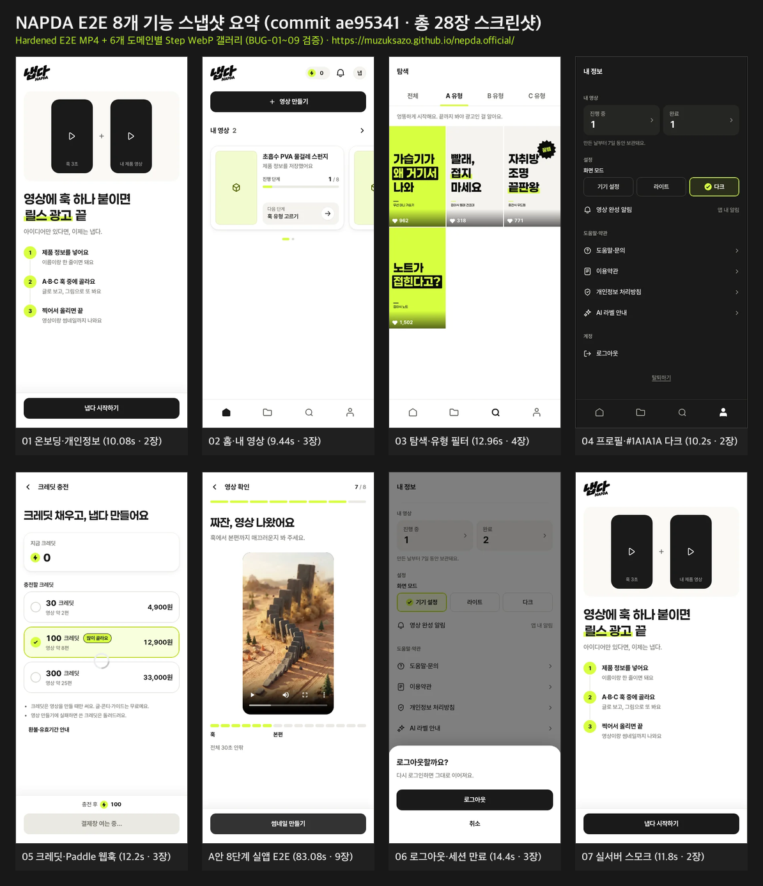

# NAPDA Full-Stack E2E 테스트 계획 및 3인 개발자 분배표

> **E2E 영상 & 도메인별 스크린샷 대시보드**: https://muzuksazo.github.io/nepda.official/ · [사용/업로드 가이드](./e2e_dashboard/README.md)  
> 최종 업데이트: 2026-11-27 (`origin/main` @ `4fb986b`, PR #14 병합 + `GeneratingScreen`/크레딧 차감·환불 반영)  
> 대상 서비스: `frontend/` (React 19 + Vite) ↔ `backend/` (FastAPI) ↔ `libraries/planner-api` (Node) ↔ `libraries/media-tools` (FFmpeg / Pillow)  
> 3인 편성: **나** (**A안**) · **시우님** (**B안**, `FR-003, FR-004, FR-005, FR-010` 전담) · **상윤님** (**C안**)

---

## 1. 로컬 풀스택 vs 실제 배포 서버(Vercel) 테스트 범위 비교

실제 프로덕션 엔드포인트(`https://napda.vercel.app` 및 `https://napda-api.vercel.app/health`)의 실측 상태와 로컬 풀스택 환경의 차이를 기준으로 역할을 나눕니다.

| 비교 항목 | 로컬 풀스택 (`uvicorn` + `vite`) | 실제 배포 서버 (`napda.vercel.app` + `napda-api.vercel.app`) |
|---|---|---|
| **역할** | **전 기능(Full-Feature) 통합 검증 및 기능별 `.mp4` 녹화** | **배포·라우팅·보안·인증·결제·번들 스모크 검증** |
| **테스트 범위** | 넓음 (`E2E-L01 ~ E2E-L13` + `E2E-ABC`) | 배포/네트워크/실계정 중심 (`E2E-P01 ~ E2E-P08`) |
| **미디어 바이너리 (`/health` 실측)** | `ffmpeg`, `ffprobe`, CJK 폰트, `media-tools` 모두 활성 | **현재 미지원** (`ffmpeg: null`, `ffprobe: null`, `font_resolved: null`, `scripts_dir_exists: false`) |
| **DB & 파일 스토리지** | 격리된 임시 SQLite (`DB_PATH`) + 로컬 디스크 → 초기화·검증 100% 재현 | `storage_backend: "local"` (`/tmp/napda/jobs.db`) → 서버리스 콜드스타트 시 영속성 제한 |
| **인증 / 세션** | `issue_session_token` HMAC 쿠키로 로그인·시드·로그아웃 완전 자동화 | 실제 Google One Tap / GIS OAuth 로그인 필요 (비로그인 `401` + 수동/실계정 검증) |
| **결제 (Paddle Sandbox)** | 실제 Sandbox `txn_...` 발급 + 서명 웹훅(`Paddle-Signature`)으로 `0 → 100` 적립 완주 | `GET /v1/billing/config` (`enabled: true`, `c30/c100/c300`) 및 웹훅 서명 검증(`401`/`200`) + 실결제 스모크 |
| **실서버 전용 검증** | 로컬 Vite 프록시만 사용 (`HTTP`) | [frontend/vercel.json](../frontend/vercel.json) `/v1/*`·`/health` 리라이트, HTTPS/Secure 쿠키, CORS, `/privacy.html`, 프로덕션 번들 무결성 |

---

## 2. 전체 E2E 테스트 케이스 매트릭스

### 2-1. 로컬 풀스택 E2E (`E2E-L01 ~ E2E-L13`)

| ID | 관련 FR | 기능 그룹 | 검증 시나리오 및 API / UI 흐름 | 녹화 파일명 규칙 |
|---|---|---|---|---|
| **E2E-L01** | Auth / Privacy | 온보딩 · 개인정보 | `/privacy.html` 200 응답 + 비로그인 `/` 진입 시 `OnboardingScreen` 및 Google 로그인 슬롯 확인 | `01_local_onboarding_privacy.mp4` |
| **E2E-L02** | Auth | 인증 세션 · 프로젝트 시드 | HMAC 세션 쿠키 발급 → `GET /v1/auth/me`, `/v1/hook-types`, `/v1/billing/config`, `POST /v1/projects` 실DB 적재 | *(공통 사전 검증 / 로그)* |
| **E2E-L03** | Core UI | 홈 · 내 영상 (`App.tsx`) | 홈(`0` 크레딧 배지, 배너, 진행 중·완료 실카드) → `내 영상` 탭 → `진행 중` / `완료` 탭 전환 | `02_local_home_my_videos.mp4` |
| **E2E-L04** | Core UI | 탐색 (구 커뮤니티) | `탐색` 탭 진입 → 추천 그리드 렌더링 → `전체` / `A 유형` / `B 유형` / `C 유형` 필터 전환 | `03_local_community_filters.mp4` |
| **E2E-L05** | Core UI | 내 정보 · `#1A1A1A` 테마 | `프로필` 탭(`냅다 E2E 테스터`, `e2e@napda.kr`, 크레딧, `7일` 보관 안내, `1/1` 카운트) → `#1A1A1A` `다크` / `라이트` / `기기 설정` 전환 | `04_local_profile_theme.mp4` |
| **E2E-L06** | `FR-006` | 크레딧 충전 · Paddle · 웹훅 | `충전하기` → `c100`(12,900원) 선택 → `POST /v1/billing/checkout`(`200`, `txn_...`) → Paddle Sandbox 오버레이 확인 → 서명 `POST /v1/billing/webhooks/paddle`(`200`) → UI **`0 → 100`** 반영 | `05_local_billing_paddle_webhook.mp4` |
| **E2E-L07** | Auth | 로그아웃 · 세션 만료 | `프로필` → `로그아웃` 시트 승인 → `POST /v1/auth/logout`(`204`) → `로그인이 풀렸어요` → `/` 온보딩 복귀 | `06_local_logout.mp4` |
| **E2E-L08** | `FR-001~014` UI | 8단계 제작 위저드 UI (`App.tsx` 연동 후) | 홈 `영상 만들기` → 제품 정보 → 훅 유형 → 시나리오 → 콘티 → 촬영 가이드 → 업로드 → 영상 확인 → 썸네일 다운로드 + 크레딧 부족 충전 복귀 ([Flow.stories.tsx](../frontend/src/ui/screens/Flow.stories.tsx) 실앱 이관) | `08_local_wizard_8step.mp4` |
| **E2E-L09a** | **`FR-003` · `FR-005`** | 시나리오 기획 · 훅 검수/교체 (**시우님 전담**) | `POST /v1/projects/{id}/hook-types` → 시나리오 기획(`planner-api`) · 교체 테스트 · 훅 검수 (`tests/planning/`, `libraries/planner-api`) | `09a_local_fr003_fr005_planning.mp4` *(또는 API 리포트)* |
| **E2E-L09b** | **`FR-004`** | 이미지 콘티 생성·수정 (**시우님 전담**) | `storyboards` 생성·조회·수정 API 및 콘티 UI 흐름 검증 (`tests/storyboards/`) | `09b_local_fr004_storyboard.mp4` |
| **E2E-L10** | `FR-001 · 002 · 007 · 009` | 제품·촬영 가이드·업로드 검증 | `POST /v1/product-info` → 촬영 가이드 API → `POST /v1/uploads/presign` → 실제 MP4 업로드(`ffprobe` 길이 5~90초·코덱 스푸핑 차단, `tests/product_info/`, `tests/filming_guide/`, `tests/uploads/`) | `10_local_upload_guide.mp4` |
| **E2E-L11a** | **`FR-005` · `FR-010`** | 훅/이미지/영상 AI 생성 · 예산 상한 (**시우님 전담**) | `POST /v1/jobs` 이미지/영상 생성, 예산 상한·서지컬 재시도, Blender 3D / 비주얼 스타일 프리셋 검증 (`tests/generation/`) | `11a_local_fr010_generation.mp4` |
| **E2E-L11b** | `FR-011` · 조립 | TTS 내레이션 · 본편 FFmpeg 조립 | Inworld/Gemini TTS 단어 정렬·LUFS 마스터링 + `body_pipeline` 본편 조립 (`tests/narration/`, `tests/integration/`) | `11b_local_tts_body_assembly.mp4` |
| **E2E-L12** | `FR-012~014` | 썸네일 · 서명 URL 미디어 전달 | 9:16 썸네일 생성 + 안전 영역 체크 + 서명 URL `Range` 스트리밍 및 변조 차단 (`tests/delivery/`) | `12_local_media_delivery.mp4` |
| **E2E-L13** | `FR-008 · 015` · Infra | 일일 쿼터 · 보관 만료 · 복구 | 일일 3회 한도, 7일 만료(`410`), 고아 잡 복구(`tests/workflow/`, `tests/credits/`) + 테스트 `.env` 격리 수정(`tests/infrastructure/`) | *(자동화 리포트)* |

---

### 2-2. A / B / C 안 개별 E2E 테스트 (각자 1안씩 담당·녹화)

> **운영 원칙**: A안(**나**) / B안(**시우님**) / C안(**상윤님**) 각자 맡은 유형의 **로컬 풀스택 End-to-End 흐름**(기획/훅 선택 → 생성·조립 → 최종 결과 확인)을 **본인이 직접 테스트 및 개별 `.mp4` 녹화**합니다.

| ID | 훅 유형 (안) | 담당자 | E2E 검증 범위 (로컬 풀스택) | 녹화 파일명 |
|---|---|---|---|---|
| **E2E-ABC-A** | **A안** | **나** | A 유형 훅 선택 → 시나리오/콘티/생성 → A안 훅+본편 결과물·썸네일 확인 | [`abc_A_hook_e2e.mp4`](./e2e_recordings/abc_A_hook_e2e.mp4) |
| **E2E-ABC-B** | **B안** | **시우님** | B 유형 훅 선택 → 시나리오/콘티/생성 → B안 훅+본편 결과물·썸네일 확인 | `abc_B_hook_e2e.mp4` |
| **E2E-ABC-C** | **C안** | **상윤님** | C 유형 훅 선택 → 시나리오/콘티/생성 → C안 훅+본편 결과물·썸네일 확인 | `abc_C_hook_e2e.mp4` |

---

### 2-3. 실제 서버 풀스택 E2E (`E2E-P01 ~ E2E-P08`)

> 대상: `https://napda.vercel.app` (프론트) + `https://napda-api.vercel.app` (백엔드)

| ID | 검증 대상 | 검증 방법 및 통과 기준 | 비고 |
|---|---|---|---|
| **E2E-P01** | 공개 페이지 & 프론트-백엔드 리라이트 | `GET https://napda.vercel.app/health` (`200`, `status: "ok"`), `/privacy.html` (`200`), `/` 온보딩 렌더, 콘솔 `pageerror`·`5xx` 0건 | **현재 통과** (`07_live_prod_smoke.mp4`) |
| **E2E-P02** | 프로덕션 Billing Config & 미인증 가드 | `GET /v1/billing/config` (`enabled: true`, `sandbox`, `c30/c100/c300`), `GET /v1/auth/me` (`401`) | **현재 통과** (`07_live_prod_smoke.mp4`) |
| **E2E-P03** | 실계정 Google One Tap 로그인 & 세션 쿠키 | `https://napda.vercel.app`에서 실제 Google 로그인 → `POST /v1/auth/google` `200` + `napda_session` Secure/HTTPS 쿠키 유지 → 새로고침 후 로그인 유지 확인 | QA 계정 반자동 녹화 (`08_live_google_auth.mp4`) |
| **E2E-P04** | 실서버 UI 탐색 · 반응형 · 다크모드 | 로그인 후 `Home` / `MyVideos` / `Community` / `Profile` 실응답 전환, 모바일(`432×932`)·데스크톱 깨짐 0건 | `09_live_ui_navigation.mp4` |
| **E2E-P05** | 실서버 Paddle Sandbox 결제 E2E | `충전하기` → `POST /v1/billing/checkout` → Paddle Sandbox 테스트 카드(`4242...`) 결제 → Paddle 서버 실웹훅 → `GET /v1/billing/orders/{id}?sync=true` → 잔액 증가 확인 | `10_live_paddle_checkout.mp4` |
| **E2E-P06** | 웹훅 HMAC 서명 보안 검증 | 무서명/변조 요청 `POST https://napda-api.vercel.app/v1/billing/webhooks/paddle` → `401 INVALID_WEBHOOK_SIGNATURE`, 정상 서명 → `200` | 자동 검증 스크립트 |
| **E2E-P07** | GitHub Actions CI/CD 자동 배포 게이트 | `.github/workflows/ci.yml` + `cd-backend.yml` 푸시 시 자동 테스트·`napda-api` 배포·스모크 체크 통과 | CI/CD 로그 |
| **E2E-P08a** | 실서버 AI/플래너 기획·생성 API 연동 (**시우님**) | 실배포 서버 환경(`VERTEX_AI` / `GEMINI_API_KEY` / `planner-api`)에서 `FR-003~005, FR-010` 기획·이미지·영상 생성 엔드포인트 스모크 | 실키 연동 후 검증 |
| **E2E-P08b** | *(인프라 확장 후)* 실서버 영상/썸네일 렌더 E2E (**상윤님**) | 외부 스토리지(R2/S3 `STORAGE_BACKEND=s3`) + 영속 DB + 별도 FFmpeg 워커 연동 후 실서버 업로드→렌더→다운로드 E2E | 현재 `ffmpeg: null`로 **보류** |

---

## 3. 3인 개발자 분배표 (나 · 시우님 · 상윤님)

각자의 영역이 겹치지 않도록 **Auth/Billing/Infra(나)** · **`FR-003, FR-004, FR-005, FR-010` AI 기획·콘티·생성(시우님)** · **Frontend UI/업로드/TTS/전달(상윤님)** 으로 분할하고, **A/B/C 안 E2E는 각자 1개씩(A: 나, B: 시우님, C: 상윤님)** 맡습니다.

### 역할별 담당 매트릭스

| 담당자 | 전담 FR / 영역 | 담당 A/B/C 안 E2E | 담당 로컬 E2E | 담당 실서버 E2E | 주요 코드 / 테스트 경로 | 목표 산출물 (DoD) |
|---|---|---|---|---|---|---|
| **나**<br>Auth · Billing(`FR-006`) · Infra · Live Ops | Google OAuth/세션, Paddle 결제/웹훅, GitHub CI/CD, Vercel 배포·운영, 테스트 `.env` 격리 | **A안** (`E2E-ABC-A`) | `E2E-L01`, `L02`, `L06`, `L07`, `L13`(`.env` 격리) | `E2E-P01`, `P02`, `P03`, `P05`, `P06`, `P07` | `backend/app/auth.py`, `paddle_billing.py`, `frontend/src/auth/`, `frontend/src/billing/`, `.github/workflows/`, `tests/credits/`, `tests/infrastructure/` | 인증·결제·실서버 스모크 `.mp4` + `abc_A_hook_e2e.mp4` + Python 단위테스트 54/54 그린 |
| **시우님**<br>**`FR-003 · FR-004 · FR-005 · FR-010` 전담** | **FR-003** 시나리오 기획, **FR-004** 이미지 콘티, **FR-005** 훅 검수·교체·생성, **FR-010** 이미지/영상 AI 생성·예산 상한·재시도·스타일 | **B안** (`E2E-ABC-B`) | `E2E-L09a`, `L09b`, `L11a` | `E2E-P08a` (실서버 기획·AI 생성 연동) | `libraries/planner-api/`, `backend/app/genai_provider.py`, `pipeline.py`, `pipeline_extras_router.py`, `tests/planning/`, `tests/storyboards/`, `tests/generation/` | `FR-003/004/005/010` E2E 녹화·리포트 + `abc_B_hook_e2e.mp4` + `planner-api` / `generation` 테스트 통과 |
| **상윤님**<br>Frontend UI · 나머지 백엔드 파이프라인 (`FR-001·002·007~009·011~015`) | 홈·내 영상·커뮤니티·프로필 UX, 8단계 제작 위저드 `App.tsx` 실연동, 촬영 가이드·업로드(`ffprobe`)·TTS(`FR-011`)·썸네일/전달(`FR-012~014`)·만료/스토리지(`FR-008·015`) | **C안** (`E2E-ABC-C`) | `E2E-L03`, `L04`, `L05`, `L08`, `L10`, `L11b`, `L12`, `L13`(쿼터/만료) | `E2E-P04`, `E2E-P08b`(R2/S3·워커 분리 후) | `frontend/src/App.tsx`, `frontend/src/ui/`, `backend/app/upload_service.py`, `filming_guide_service.py`, `tts_service.py`, `body_pipeline.py`, `thumbnail_service.py`, `media_delivery.py`, `storage.py`, `retention.py`, `tests/uploads/`, `tests/narration/`, `tests/delivery/`, `tests/workflow/` | UI·위저드·업로드·전달 기능별 `.mp4` + `abc_C_hook_e2e.mp4` + `oxlint`/`vite build` 0 error |

### 협업 규칙 (충돌 방지 및 병합 게이트)
1. **PR 전 공통 게이트**:
   - Python: `.venv/bin/python scripts/test-python.py`
   - Node/Planner: `npm test && npm run typecheck && npm run build`
   - Frontend: `npm --prefix frontend run lint && npm --prefix frontend run build`
   - 본인이 수정한 기능의 **개별 `.mp4` 녹화본**을 PR 코멘트 또는 내부 QA 폴더에 첨부 (`pageerror === 0`, 예기치 않은 `5xx === 0`).
2. **녹화 파일 명명 및 저장 규칙**:
   - 공통/인프라/파이프라인: `<순번>_<local|live>_<feature_slug>.mp4` (예: `08_local_wizard_8step.mp4`, `10_live_paddle_checkout.mp4`)
   - A/B/C 안 각자 녹화본: `abc_A_hook_e2e.mp4` (**나**) · `abc_B_hook_e2e.mp4` (**시우님**) · `abc_C_hook_e2e.mp4` (**상윤님**)
   - 경량 E2E 증빙 녹화본(`.mp4`)은 [`tests/e2e_recordings/`](./e2e_recordings/)에 보관(루트 `.gitignore`에서 `!tests/e2e_recordings/*.mp4` 예외 허용)하고, 임시 SQLite DB 및 대용량 원본 미디어는 Git에 커밋하지 않음.
3. **선행 조치 (나 담당 — 완료)**:
   - [test_genai_config.py](./infrastructure/test_genai_config.py) 3건과 [test_backend_api.py](./integration/test_backend_api.py) 1건의 로컬 `backend/.env` 누수 현상을 `Settings(_env_file=None, ...)`로 격리 완료 → Python 회귀 테스트 **54/54 통과**.

---

## 4. 표준 실행 명령어

### 4-1. 오프라인 전체 회귀 + 빌드
```bash
.venv/bin/python scripts/test-python.py
npm test && npm run typecheck && npm run build
npm --prefix frontend run lint && npm --prefix frontend run build
```

### 4-2. 로컬 풀스택 + 실서버 스모크 기능별 E2E 녹화 (아티팩트 출력)
- 격리 포트(`18080` 백엔드, `15173` 프론트엔드) + 임시 `DB_PATH`/`WORK_ROOT`/`OUTPUT_DIR`로 실행하므로 개발 중인 `:5173` 서버 및 로컬 DB를 건드리지 않습니다.
- Playwright `recordVideo`(컨텍스트 기능별 1개씩 생성) → `ffmpeg`로 H.264 `.mp4`(`432×932`) 변환 + `pageerror`/`5xx` 자동 검사.
- **대시보드 등록·업로드 방법**: [tests/e2e_dashboard/README.md](./e2e_dashboard/README.md) 참고 (`tests/e2e_recordings/`에 `.mp4` 추가 + `manifest.json` 갱신 후 푸시 시 GitHub Pages 자동 반영).

---

## 5. 최신 실행 결과 기록 (2026-11-27 `ae95341` + BUG-01~09 하드닝 기준 · 6개 도메인 28장 스크린샷)



| 기능 녹화 파일 | 도메인 | 대상 환경 | 재생 시간 / 크기 / 스크린샷 | 검증 결과 | 핵심 확인 사항 |
|---|---|---|---|---|---|
| [`01_local_onboarding_privacy.mp4`](./e2e_recordings/01_local_onboarding_privacy.mp4) | 인증 · 온보딩 | Local (`:15175` → `:18082`) | `10.08s` / 100 KB / 2장 | **PASS** | `/privacy.html` `200`, 비로그인 온보딩 화면·Google 로그인 슬롯, 에러 0건 |
| [`02_local_home_my_videos.mp4`](./e2e_recordings/02_local_home_my_videos.mp4) | 홈 · 내 영상 · 탐색 | Local (`:15175` → `:18082`) | `9.44s` / 69 KB / 3장 | **PASS** | 통합 `내 영상 2` 캐러셀 실DB 시드 2건 표시 + 미읽은 배지 `0`·목업 배너/도마왕 미노출 + `내 영상` `진행 중`/`완료` 탭 전환 정상 |
| [`03_local_community_filters.mp4`](./e2e_recordings/03_local_community_filters.mp4) | 홈 · 내 영상 · 탐색 | Local (`:15175` → `:18082`) | `12.96s` / 160 KB / 4장 | **PASS** | `탐색` 탭 그리드 + `전체`·`A`·`B`·`C 유형` 필터 전환 정상 |
| [`04_local_profile_theme.mp4`](./e2e_recordings/04_local_profile_theme.mp4) | 프로필 · 테마 설정 | Local (`:15175` → `:18082`) | `10.20s` / 189 KB / 2장 | **PASS** | 크레딧 내역 빈 상태(`아직 텅 비었어요`), `개인정보 처리방침` `/privacy.html` 새 탭 오픈, 회원 탈퇴 고객지원 안내 시트 + `#1A1A1A` `다크`/`라이트`/`기기 설정` 테마 전환 정상 |
| [`05_local_billing_paddle_webhook.mp4`](./e2e_recordings/05_local_billing_paddle_webhook.mp4) | 결제 · 크레딧 (Paddle) | Local (`:15175` → `:18082`) | `12.20s` / 118 KB / 3장 | **PASS** | 0크레딧 `POST /renders` `402 INSUFFICIENT_CREDITS` 가드 통과 + `POST /v1/billing/checkout`(`ord_1114fc35d14b`) + Paddle Sandbox 오버레이 + 실서명 웹훅 → 잔액 **`0 → 100`** |
| [`abc_A_hook_e2e.mp4`](./e2e_recordings/abc_A_hook_e2e.mp4) (**나 담당 A안**) | 영상 제작 · 8단계 위저드 | Local (`:15175` → `:18082` + Track A) | `83.08s` / 744 KB / 9장 | **PASS** | 실제 앱 8단계 완주: `제품 정보` → `A 유형`(`시안 없이 냅다 만들기` 왕복 검증 포함) → `시나리오`(`6.5초` 정렬·내부ID 미노출) → **`4/8 그림 콘티`**(4컷 `/v1/media/` 실이미지) → `촬영 가이드` → 8.5초 MP4 `영상 올리기` → `GeneratingScreen` → Track A 실렌더(`7/8 영상 확인` `<video>`·MP4 `200`) → `8/8 썸네일·내려받기`(실 `/v1/media/` 3종 프리뷰 + `띠지`/`line_blocks` PNG `>10KB` 검증), HTTP `>=400`·에러 0건 |
| [`06_local_logout.mp4`](./e2e_recordings/06_local_logout.mp4) | 인증 · 온보딩 | Local (`:15175` → `:18082`) | `14.40s` / 169 KB / 3장 | **PASS** | `POST /v1/auth/logout` `204` → `로그인이 풀렸어요` → 홈 온보딩 복귀 |
| [`07_live_prod_smoke.mp4`](./e2e_recordings/07_live_prod_smoke.mp4) | 실서버 배포 스모크 | Live (`https://napda.vercel.app`) | `11.80s` / 103 KB / 2장 | **PASS** | `/health` `200`(`status: ok`), `/v1/billing/config` `200`(`paddle`/`sandbox`, 3종), `/v1/auth/me` `401`, `/privacy.html` `200`, `/` 온보딩 정상 |
| `E2E-P06` (API 보안 검증) | 결제 · 크레딧 (Paddle) | Live (`https://napda-api.vercel.app`) | — | **PASS** | 무서명 `401`, 변조 서명 `401`, 정상 HMAC-SHA256 `200` (`received: true`, `credited: false`) |

- **오프라인 테스트 현황 (`4fb986b` 기준)**: Python **54/54 통과**, Node **7/7 통과** (`typecheck`/`build` 포함), Frontend `oxlint` 0 error & `vite build` 통과.
- **남은 실서버 대화형 QA (실계정 Google 로그인 필요)**: `E2E-P03` (실계정 Google 로그인/쿠키 유지), `E2E-P05` (실서버 Paddle Sandbox 테스트 카드 결제).
